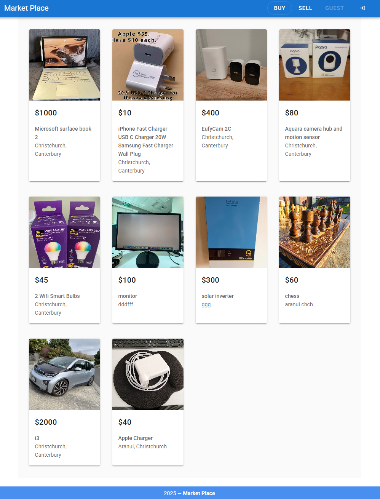
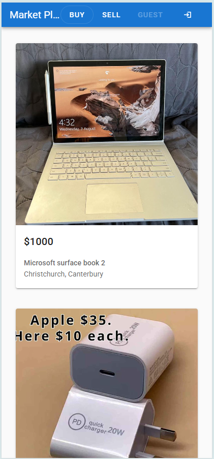

# 🛍️ Market-Place: A Vue.js Frontend Application

This is a front-end application for a marketplace, built using Vue.js and the Vuetify component framework. It's designed to provide a user interface for browsing and interacting with products.

## ✨ Features (Planned or Implemented)

- Product listing and browsing
- Product detail views
- User interaction (e.g., adding to cart, searching - likely requires a backend)
- Responsive design for various screen sizes
- Upload image to: https://api.imgbb.com/

## 🖼️ Screenshots

| Desktop                                              | Mobile                                              |
| ---------------------------------------------------- | --------------------------------------------------- |
|  |  |

## 🚀 Live Demo

### URL: https://market-place-c2c.netlify.app/

## 🛠️ Tech Stack

This project is built with the following core technologies:

- **Frontend Framework:** [Vue.js](https://vuejs.org/) (v2.6.14)
- **UI Component Library:** [Vuetify](https://vuetifyjs.com/) (v2.6.0) - A Material Design component framework for Vue.
- **HTTP Client:** [Axios](https://axios-http.com/) (v0.27.2) - For making API requests to a backend.
- **Core JavaScript:** [Core-js](https://github.com/zloirock/core-js) (v3.8.3) - Polyfills for modern JavaScript.
- **Form Data:** [form-data](https://github.com/form-data/form-data) (v4.0.0) - For creating `multipart/form-data` streams (often used for file uploads).

**Development & Tooling:**

- **Build Tool:** [Vue CLI](https://cli.vuejs.org/) (~5.0.0)
- **JavaScript Compiler:** [Babel](https://babeljs.io/) (@babel/core v7.12.16)
- **Linter:** [ESLint](https://eslint.org/) (v7.32.0) with `eslint-plugin-vue` (v8.0.3)
- **CSS Preprocessor:** [Sass](https://sass-lang.com/) (~1.32.0) via `sass-loader` (v10.0.0)

## 🚀 Getting Started

Follow these instructions to get a copy of the project up and running on your local machine for development and testing purposes.

### Prerequisites

- [Node.js](https://nodejs.org/) (LTS version recommended, e.g., v16, v18, or v20+)
- [npm](https://www.npmjs.com/) (comes with Node.js) or [Yarn](https://yarnpkg.com/)

### APIs:

- https://github.com/jericrealubit/api-users/
- https://github.com/jericrealubit/api-posts/
- https://github.com/jericrealubit/api-messages/

### Installation

1.  **Clone the repository:**

    ```bash
    git clone https://github.com/jericrealubit/market-place.git
    cd market-place
    ```

2.  **Install dependencies:**
    Using npm:

    ```bash
    npm install
    ```

    Or using Yarn:

    ```bash
    yarn install
    ```

3.  **Environment Variables (Optional but Recommended):**
    If your application needs to connect to a backend API, it's good practice to use environment variables. Create a `.env.local` file in the root of the project (this file should be ignored by Git):
    ```
    VUE_APP_API_BASE_URL=http://your-api-backend-url.com/api
    ```
    You can then access this in your Vue components using `process.env.VUE_APP_API_BASE_URL`.

## 📜 Available Scripts

In the project directory, you can run the following scripts:

### `npm run serve` or `yarn serve`

Compiles and hot-reloads the application for development.
Open [http://localhost:8080](http://localhost:8080) (or the port specified in your Vue CLI config) to view it in your browser. The page will reload when you make changes.

### `npm run build` or `yarn build`

Compiles and minifies the application for production.
The build artifacts will be stored in the `dist/` directory.

### `npm run lint` or `yarn lint`

Lints and checks your code for style and potential errors according to the ESLint configuration.

## 📁 Project Structure (Simplified)

```bash
market-place/
├── public/ # Static assets (index.html, favicon, etc.)
├── src/ # Main application source code
│ ├── assets/ # Static assets processed by Webpack (images, fonts)
│ ├── components/ # Reusable Vue components
│ ├── views/ # Page-level components (routed)
│ ├── router/ # Vue Router configuration (if used)
│ ├── store/ # Vuex store modules (if used)
│ ├── App.vue # Root Vue component
│ └── main.js # Main entry point for the application
├── .env.local # (Optional) Local environment variables (ignored by Git)
├── .eslintrc.js # ESLint configuration
├── babel.config.js # Babel configuration
├── package.json # Project metadata and dependencies
├── README.md # This file
└── vue.config.js # (Optional) Vue CLI configuration
```

## 🤝 Contributing

Contributions are welcome! If you have suggestions or want to contribute code:

1.  Fork the Project
2.  Create your Feature Branch (`git checkout -b feature/AmazingFeature`)
3.  Commit your Changes (`git commit -m 'Add some AmazingFeature'`)
4.  Push to the Branch (`git push origin feature/AmazingFeature`)
5.  Open a Pull Request

Please ensure your code adheres to the existing style and passes linting checks.

## 📄 License

This project is currently unlicensed. Consider adding an open-source license (e.g., MIT, Apache 2.0) by creating a `LICENSE` file in the root of the repository if you intend for others to use, modify, or distribute your code.
